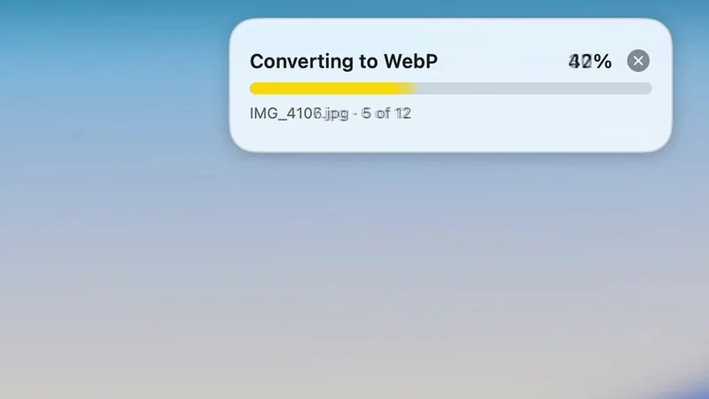

<p align="center">
  
</p>

<h1 align="center">Camomilla</h1>

<p align="center">
  A free menu bar app for macOS that converts files while you drag them.<br>
  Drag a file, hold Shift, pick a petal. Done.
</p>

<p align="center">
  <a href="https://github.com/roaringsoul404/camomilla/releases/latest/download/Camomilla.dmg"><b>Download Camomilla.dmg</b></a>
  &nbsp;·&nbsp;
  <a href="https://camomilla.app">camomilla.app</a>
</p>

<p align="center">
  Free · 8 MB · Apple silicon · macOS 14 or later
</p>

<p align="center">
  
</p>

This repository holds the releases of the app. The code of the app is not published here.

## How it works

1. Drag a file from the desktop, from Finder or from almost any app.
2. Hold Shift while you drag. A flower with seven petals opens around the pointer, with the size of the file in its heart.
3. Drop the file on a petal. Camomilla writes the copy next to the original, and the original stays as it is.

Hold Option and Shift instead, and the flower shows the tools: compress, remove metadata, crop and more.
You can choose the petals of each flower, their order and the keys in Settings.

You can also work without dragging. Choose Convert Files… in the menu bar, then click a petal or use the arrow keys and Return.
In Finder, right-click a file and open Quick Actions.

## What it converts

| Family | Formats | Tools |
|---|---|---|
| Images | JPG, PNG, HEIC, TIFF, WebP, GIF, PDF | Compress, Metadata, Annotate, Backdrop, Crop, Redact, AirDrop |
| Video | MP4, HEVC, WebM, GIF, WebP, M4A, one frame as PNG | Compress, Speed, Mute, Metadata, Downscale, Crop, AirDrop |
| Audio | MP3, AAC, FLAC, WAV, OGG, Opus | Clean, Normalize, Trim Silence, Mono, Metadata, Compress, AirDrop |
| Documents | PDF, DOCX, TXT, Markdown, HTML, RTF, ODT, EPUB, SRT, VTT | For a PDF: Compress, Metadata, Split, Pages |
| Archives | ZIP, 7Z, TAR.GZ | |

A PDF with text becomes DOCX, EPUB, Markdown, HTML, RTF or ODT, with the text reflowed.
WMA, WMV and AVI files open too. PowerPoint and Excel files need LibreOffice, which you can install from Settings → Formats.
A petal is gray when it does not fit the file, for example the format that the file already has.

## After each conversion

A card shows the new file with its size before and after. From the card you can:

- drag the thumbnail into another app,
- show the file in Finder,
- send it with AirDrop,
- undo: the new files go to the Trash.

Recent in the menu bar lists the last files that Camomilla made. Undo in the menu bar works on the last jobs too.

When one job makes more than five files, they go in a new folder next to the originals, such as “Spring Shoot WebP”.
You can turn this off in Settings → Output.

<p align="center">
  
</p>

## Install

[Download Camomilla.dmg](https://github.com/roaringsoul404/camomilla/releases/latest/download/Camomilla.dmg)

1. Open the disk image.
2. Drag Camomilla to Applications.
3. Open Camomilla from Applications, not from the disk image: only that copy updates itself.

Or paste this in Terminal:

```sh
curl -fsSL https://camomilla.app/install.sh | sh
```

The command downloads the latest version from this page, checks its SHA-256 sum, copies Camomilla to Applications and opens it.
It doesn’t use sudo. macOS opens Camomilla without the steps below. [Read the script](https://camomilla.app/install.sh).

Requirements: a Mac with Apple silicon and macOS 14 or later.

## The first time you open it

Camomilla is not notarized by Apple, so the first time macOS stops the copy you downloaded from the browser. You allow it once:

1. Open Camomilla from Applications. When macOS says it can’t be opened, click Done.
2. Open System Settings, then Privacy & Security, and scroll down to Security.
3. Next to the line about Camomilla, click Open Anyway.
4. Confirm with Touch ID or your password. Camomilla opens, and macOS won’t ask again, not even after updates.

On macOS 14 Sonoma, Control-click Camomilla in Applications, choose Open, then click Open.

## Privacy

Camomilla has no account and no analytics. It converts your files on your Mac.
A file leaves your Mac only if you send it, for example with AirDrop.

Camomilla goes online only for these things:

- to check for updates once a day, if you allowed it on the second launch (Settings → About),
- to download LibreOffice, if you choose to install it,
- to send a problem report, if you send one yourself by email or on GitHub.

Screen Recording is optional. It only matters on macOS 26 with the Glass style: the flower draws its glass from the area behind it.

## License

Camomilla is free for personal use and for work, under the terms in [LICENSE](LICENSE).
Do not publish the app anywhere else: share the link to this page.

## Source code of the included programs

Camomilla includes FFmpeg and LAME, which are under the GNU LGPL.
Each release has their source code, with the script that builds them, in the file
`Camomilla-<version>-included-programs-source.zip`. `SHA256SUMS.txt` lists the checksums of the files of the release.

## Problems

To report a problem, write to support@camomilla.app. Say what you dragged, which petal you chose and which version of macOS you use.
Camomilla is a free project: there is no promise of an answer or of a fix.

Made by Roaring Soul.
